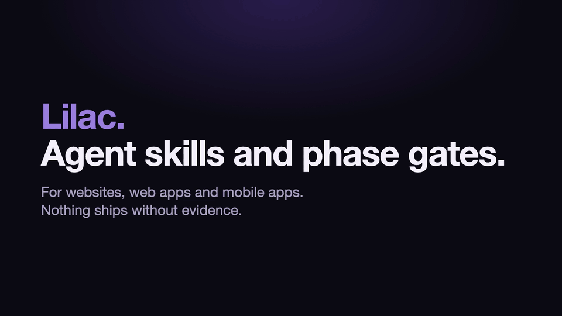
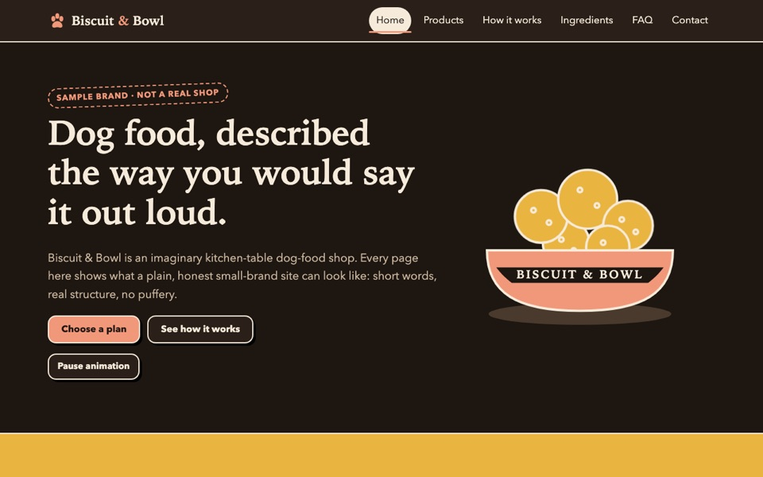
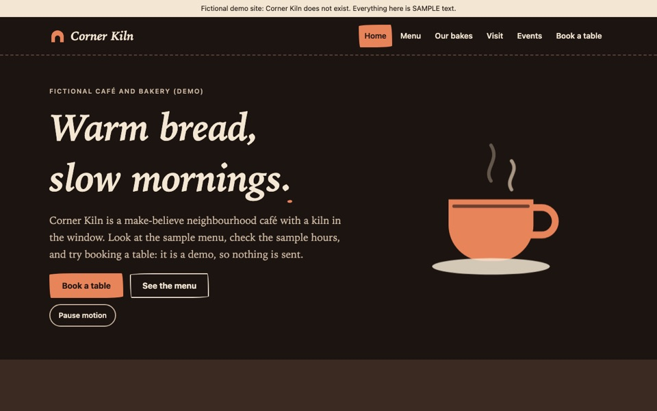
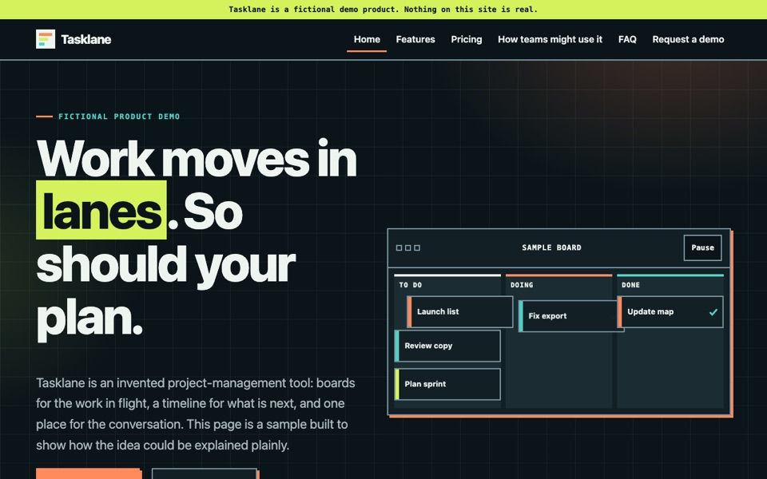
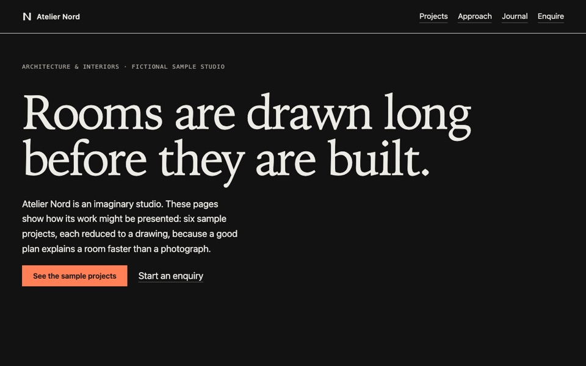
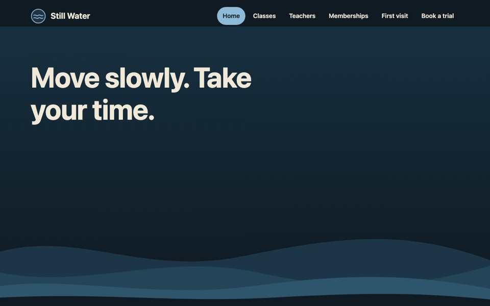
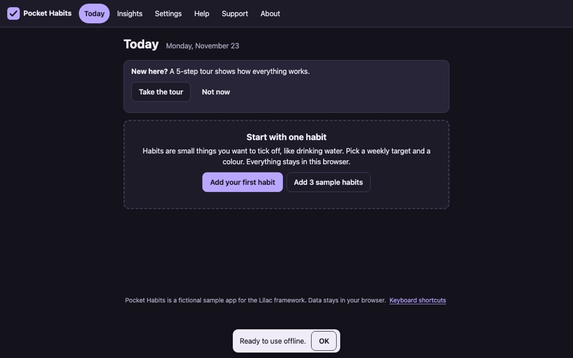
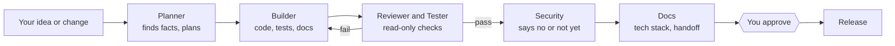

<p align="center"></p>

<p align="center">
  <a href="https://github.com/DevPatel128/lilac-plugin/actions/workflows/ci.yml"></a>
  
  
  
  
</p>

<h3 align="center">Describe the website or web app you want. Lilac helps your AI tool build it, then proves it works.</h3>

<p align="center">
  <a href="#quick-start">Quick start</a> ·
  <a href="#see-what-it-makes">Examples</a> ·
  <a href="docs/USER-GUIDE.md">User guide</a> ·
  <a href="AGENTS.md">For AI agents</a> ·
  <a href="#honest-status">Honest status</a> ·
  <a href="SECURITY.md">Security</a>
</p>

**Lilac is a set of agent skills and seven specialist agents that help an AI coding tool build a website or web app, and then prove it is ready before it ships.** You do not need to be technical: you describe what you want, Lilac asks the right questions, builds in small steps, and checks errors, speed, accessibility, security and the buying path before anything goes live. Every phase ends with a check that needs evidence, not a promise.

<p align="center"><br><a href="assets/lilac-demo.mp4">Watch the demo as a video</a></p>

## What you get

| | |
|---|---|
| **37 skills** | Plan, build, secure and launch a site or web app; test it with a real browser and simulated visitors; write the docs; prove a fix worked. See the table below. |
| **7 agents** | Planner, Builder, Reviewer, Tester, Security, Docs, Release. Each has a one-page contract and the tools it is allowed to use. |
| **One command for docs** | `node scripts/techdocs.mjs` writes your tech-stack page (with diagrams), interview prep and social-media drafts, from your own code. |
| **An email quality check** | If your product sends email, the docs check fails until there is a reusable template, a plain-text copy, dark mode, a preheader and escaped user text. |
| **Handoff in three formats** | `node handoff/handoff.mjs <project>` writes `HANDOFF.md`, a PDF and a short slide deck: what was built, how to run it, risks and next steps. Anything it cannot find in your repo says `UNKNOWN`. The PDF needs Google Chrome installed. |
| **Eight tool formats** | Claude Code, Cursor, Codex, Gemini CLI, Copilot, Windsurf, Cline and Antigravity. |

## Quick start (Claude Code)

```text
/plugin marketplace add DevPatel128/lilac-plugin
/plugin install lilac@lilac
```

Then type `/lilac:doctor`. It checks your computer and says "Lilac is ready", or tells you exactly what to fix.

| Type | To |
|---|---|
| `/lilac:lilac <idea or change>` | Plan, build, check and document it |
| `/lilac:foundation` | Decide the architecture, languages, tools and brand kit first, and approve them before building |
| `/lilac:brief` | Interview you and write a checked brief before building. [Prompt tips](docs/PROMPTING.md) |
| `/lilac:preview` | Look at the site locally and say yes before anything is published |
| `/lilac:persona-test` | About 100 simulated visitors try the main tasks (not real people) |
| `/lilac:hosting` | Choose where to host: Cloudflare (default), Vercel, or either with Supabase. Code always lives on GitHub |
| `/lilac:qa` | Automatic error, accessibility, speed and security checks |
| `/lilac:docs` | Write the tech-stack page, interview prep and social drafts |
| `/lilac:project-handoff` | Write a handoff document, PDF and slides |
| `/lilac:learning on` or `off` | Switch the optional local learning (off by default) |
| `/lilac:help` | Show this list |

Other tools: see [docs/INSTALL.md](docs/INSTALL.md).

## Read this first

| You are | Read |
|---|---|
| A person using Lilac | [docs/USER-GUIDE.md](docs/USER-GUIDE.md) |
| An AI agent working in a project that has Lilac | [AGENTS.md](AGENTS.md) |
| Stuck | [docs/TROUBLESHOOTING.md](docs/TROUBLESHOOTING.md) |

## See what it makes

Six finished examples, all for fictional brands, built through Lilac's workflow. Each has its brief, build log and the exact results of every check, including the failures and what was accepted.


<table>
<tr>
<td width="33%"><a href="examples/sites/dog-food/"></a><br><b>Biscuit &amp; Bowl</b><br>Dog-food shop with a plan builder</td>
<td width="33%"><a href="examples/sites/cafe/"></a><br><b>Corner Kiln</b><br>Neighbourhood café and bakery</td>
<td width="33%"><a href="examples/sites/saas/"></a><br><b>Tasklane</b><br>Project-management SaaS landing site</td>
</tr>
<tr>
<td><a href="examples/sites/studio/"></a><br><b>Atelier Nord</b><br>Architecture and interiors studio</td>
<td><a href="examples/sites/fitness/"></a><br><b>Still Water</b><br>Yoga and movement studio</td>
<td><a href="examples/apps/habits/"></a><br><b>Pocket Habits</b><br>A working habit-tracker web app, installable and offline</td>
</tr>
</table>

| Example | What it is | Folder |
|---|---|---|
| Biscuit & Bowl | Dog-food shop with a plan builder | [`examples/sites/dog-food/`](examples/sites/dog-food/) |
| Corner Kiln | Neighbourhood café and bakery | [`examples/sites/cafe/`](examples/sites/cafe/) |
| Tasklane | Project-management SaaS landing site | [`examples/sites/saas/`](examples/sites/saas/) |
| Atelier Nord | Architecture and interiors studio | [`examples/sites/studio/`](examples/sites/studio/) |
| Still Water | Yoga and movement studio | [`examples/sites/fitness/`](examples/sites/fitness/) |
| Pocket Habits | A working habit-tracker web app, installable and offline | [`examples/apps/habits/`](examples/apps/habits/) |

Run one yourself (for example the café):

```text
node examples/sites/serve.mjs cafe 4174
```

then open http://127.0.0.1:4174. For the web app: `node examples/apps/serve.mjs habits 4180`. None of them is for sale and none makes health or business claims; they are demos. Each folder's `RESULTS.md` is the honest record, and `simulated visitors` there are scripted, not real people.

## How a task flows



The Planner, Reviewer, Tester and Security agents have no file-edit tool (they can still run commands). The Release agent's instructions require your recorded approval before it deploys, sends or posts. No agent is given production access. In Claude Code these limits are enforced by each agent's tool list; in some other tools they rest on the agent's written instructions (see [docs/INSTALL.md](docs/INSTALL.md)).

## The skills

| Skill | What it does |
|---|---|
| `lilac` | Runs the full loop on an idea or a change |
| `phase-1-build` · `phase-2-secure` · `phase-3-launch` | The three phases and their checks |
| `tech-docs` | Generates the tech-stack page, interview prep and showcase drafts |
| `verify` | Proves or disproves one claim with fresh before/after evidence |
| `guard` | Rules for what agents may do and what needs your approval |
| `skillspector` | Scans a skill or plugin before you install it |
| `tech-decision` | Decides whether to adopt a library or service, from evidence |
| `grill-with-docs` | Interviews a plan until it is sharp, and records the decisions |
| `mistakes-root-cause-logger` | Records a bug with its root cause and the check that prevents it |
| `api` · `auth` · `email` | Build an API, sign-in, or customer email properly |
| `requirements` · `fidelity` · `converge` · `references` · `context` · `craft-review` | Turn the brief into numbered requirements, prove each one on the built site, fix misses; take tokens from sites you like; read your own repos; score craft |
| `motion` · `performance` · `compliance` · `privacy-analytics` · `owner-editing` · `research-refresh` | Motion tiers and licences, performance budgets, WCAG 2.2 and EAA, consent and analytics, owner editing and forms, sourced knowledge refresh |
| `severity` · `status` · `statusline` | A 1 to 10 dial for how strict the gates are; every approval as approved, stale or pending; a progress bar |
| `brief` · `foundation` | Read a BRIEF block or interview you (two screens) into a checked brief; decide architecture and brand kit first, with your approval |
| `build` · `blocks` · `features-content` · `features-server` | Build in small steps from tested blocks; add content, forms, sign-in and payments safely |
| `qa` · `controls-test` · `persona-test` · `persona-review` · `ux-review` | Browser checks for errors and dead buttons; simulated visitors; UX review (all labelled as simulated, never real users) |
| `funnel` | Checks the path from visitor to buying customer, with no conversion claims |
| `hosting` · `preview` · `launch` · `change` | Choose a host (Cloudflare by default), preview and approve, launch, and make later changes safely |
| `ship` | Takes a finished branch through checks, pull request and deploy |
| `handoff` | Writes a handoff note another agent can pick up |

## Privacy

Lilac has no server and no accounts. What it learns about your work stays in `~/.lilac/` on your machine, redacted. The optional learning hook is **off** until you turn it on, records only the task text, outcome, failed checks and rework count, and makes no network calls. Delete everything with `rm -r ~/.lilac`. Full details: [PRIVACY.md](PRIVACY.md).

## Honest status

This is a pre-release. Here is what has and has not been tested.

| Area | Status |
|---|---|
| Install into Claude Code | Tested: validate, marketplace add and install in an isolated temporary profile |
| Cursor, Codex, Gemini CLI, Copilot, Windsurf, Cline, Antigravity | Files are generated in each tool's documented format and checked for structure. A real install in each tool has **not** been tested |
| Windows, Linux, macOS | The plugin's own checks run in CI on all three on every commit (see the CI badge). Browser checks run on Linux in CI and on macOS locally; the browser tools have not been run on Windows |
| Skills that mention Lilac's starter-kit scripts | Some skills point to scripts from the full Lilac starter kit, which is not part of this plugin yet. Links to skills outside this pack are shown as plain text marked "(not in this pack)" |
| Speed or quality compared with other tools | Not measured. Lilac makes no such claim |

Details and sources for every tool format: [docs/INSTALL.md](docs/INSTALL.md) and [docs/ADAPTERS.md](docs/ADAPTERS.md).

<details>
<summary><b>FAQ</b></summary>

**Does Lilac send my code anywhere?** No. The plugin makes no network calls on its own, and a check on every build allowlists each exception. The only tool that reaches the internet is `scripts/monitor.mjs`, and it only runs when you pass it a URL. Your AI tool still talks to its own provider as usual.

**Will the agents change my code without asking?** Only the Builder and Docs agents have file-edit tools. Deploying, sending email and posting need your approval.

**Can I use only some skills?** Yes. Each skill is a folder with a `SKILL.md`; copy the ones you want.

**How does it get better with use?** The optional learning hook records outcomes locally. Repeated failures become draft lessons, and a lesson becomes a rule only after you approve it and an evaluation shows no drop in score.

**Is it open source?** The plugin is released under the MIT licence. Please read [DISCLAIMER.md](DISCLAIMER.md): the software is provided as is, AI output must be reviewed by a qualified person, and Lilac's checks are automated aids, not certification.
</details>

## Contributing and security

[DISCLAIMER.md](DISCLAIMER.md) · [docs/LEGAL.md](docs/LEGAL.md) · [TRADEMARKS.md](TRADEMARKS.md) · [CONTRIBUTING.md](CONTRIBUTING.md) · [SECURITY.md](SECURITY.md) · [CODE_OF_CONDUCT.md](CODE_OF_CONDUCT.md) · [SUPPORT.md](SUPPORT.md) · [NOTICE](NOTICE) lists the licences of included third-party skills.

© 2026 Dev Patel. MIT licence.
