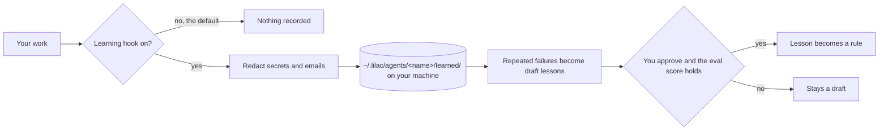

# How Lilac works

## The three phases

| Phase | Goal | Ends when |
|---|---|---|
| 1. Build | Choose the architecture and design, build the product with baseline security, no real customer data | Local checks pass with recorded evidence |
| 2. Secure | Harden everything for real customers: security, speed, monitoring | Checks pass in CI and on the running product |
| 3. Launch | Strongest security proof, then go-to-market, pricing and the business plan | You approve; every check has evidence |

A check passes only with evidence: the command that was run and its result. "It should work" is not evidence.

## The agents

| Agent | Job | File-edit tools (Edit, Write) |
|---|---|---|
| Planner | Finds out what is true, then plans | No |
| Builder | Writes the code, tests and docs | Yes |
| Reviewer | Checks the work independently | No |
| Tester | Runs the checks | No |
| Security | Reviews risky work; says no or not yet, never approves | No |
| Docs | Writes the tech docs and handoff | Yes |
| Release | Prepares shipping; its instructions require your recorded approval to deploy, send or post | No |

## Where the data goes

Each agent reads only its own folder. A lesson from one agent cannot be promoted into another agent's rules.

## The tech docs command

`node scripts/techdocs.mjs` reads your repository and writes three files:

- `architecture/TECH-STACK.md`: languages, services, where each lives in the code, and a diagram of how each works.
- `governance-learning/INTERVIEW-PREP.md`: questions an interviewer is likely to ask about this project, and which file answers each.
- `product-growth/SHOWCASE.md`: social-media drafts built only from facts found in the code. Numbers you must measure yourself are left as `[YOUR ...]`.

`node scripts/techdocs.mjs --check` fails when the docs are stale, a section has no diagram, or email is below standard.

Agents without file-edit tools can still run shell commands. The limit is on the editing tools, not on the shell.
