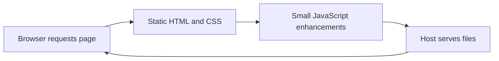
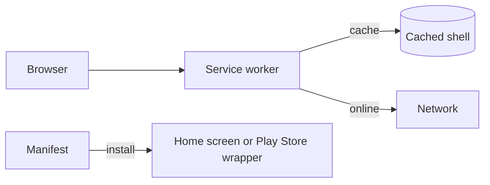
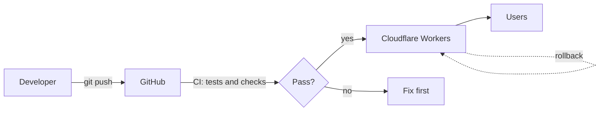

# pocket-habits-demo: tech stack

<!-- generated by operations/scripts/techdocs.mjs; stack-hash: 14aef5a1ee2e. Edit the code, then regenerate. Do not hand-edit. -->

One page that explains what this product is built with, where each part lives, and how it works. Every row was found in the repo, none is guessed.

## Languages

| Language | Source files |
|---|---|
| JavaScript | 18 |
| HTML | 3 |
| CSS | 2 |

## Services at a glance

| Part | Tech found | Where in the code |
|---|---|---|
| Website (plain HTML, CSS, JavaScript) | _none found_ | `brand/brand-sheet.html`, `site/404.html` |
| Installable app (PWA / TWA) | _none found_ | `site/manifest.webmanifest` |
| Hosting and deployment | `Cloudflare Workers` | `wrangler.jsonc` |

## Website (plain HTML, CSS, JavaScript)

**What it does:** Pages written as plain HTML and CSS, with small JavaScript for the interactive parts. No framework and no build step: the host sends the files as they are.

**Tech found:** _none found_

**Where in the code:** `brand/brand-sheet.html`, `site/404.html`, `site/index.html`, `brand/tokens.css`, `site/app.css`

**How it works**

## Installable app (PWA / TWA)

**What it does:** The web app can be installed and run offline, or wrapped for the Play Store.

**Tech found:** _none found_

**Where in the code:** `site/manifest.webmanifest`

**How it works**

## Hosting and deployment

**What it does:** Where the code runs and how a change reaches users.

**Tech found:** `Cloudflare Workers`

**Where in the code:** `wrangler.jsonc`

**How it works**

## Motion

What moves on screen and whether it stays accessible. Found by reading CSS, HTML and JavaScript.

**Kinds of motion:** `CSS keyframe animation`, `CSS transitions`

**Reduced motion respected:** yes, `prefers-reduced-motion` found in `brand/brand-sheet.html`, `brand/tokens.css`, `site/app.css`

**Hidden-until-revealed classes guarded for no-JS:** not applicable, no initial-hidden reveal classes found

## Interactive forms without a backend

Forms with no `action` found in `site/index.html`. A static host cannot receive a submit. Either handle it in JavaScript (and say so on the page), post to a form service or function, or remove the form.
